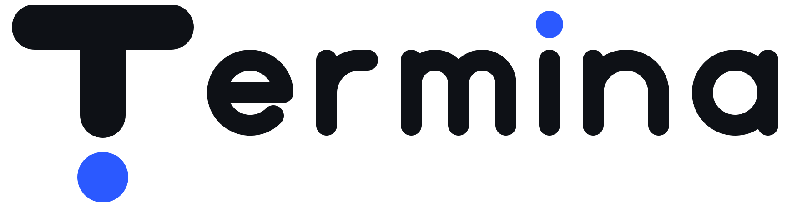
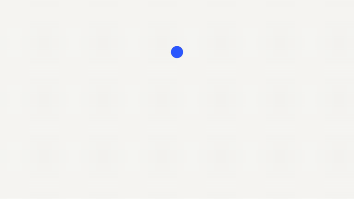
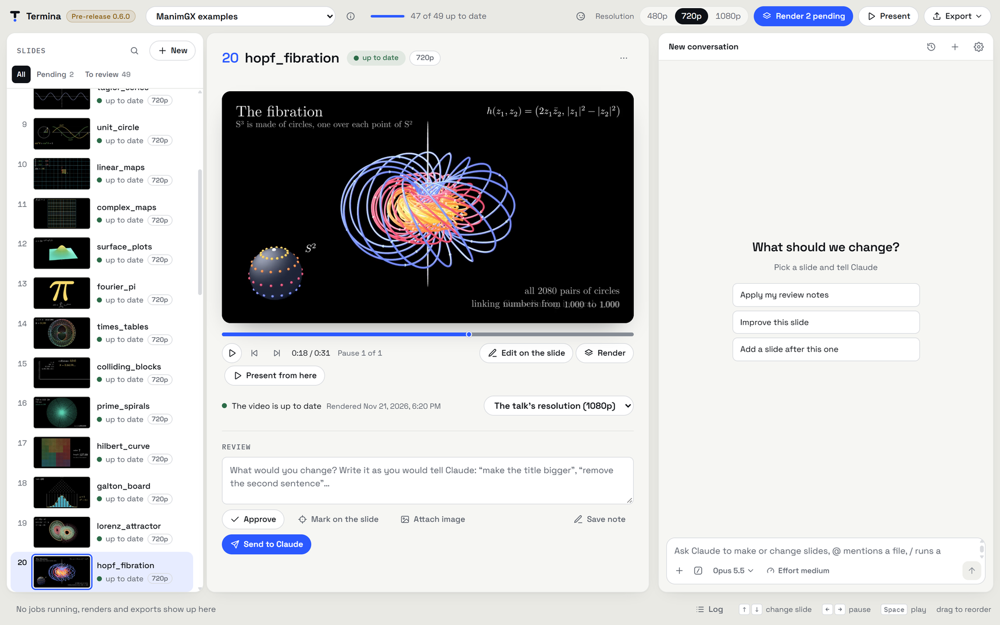
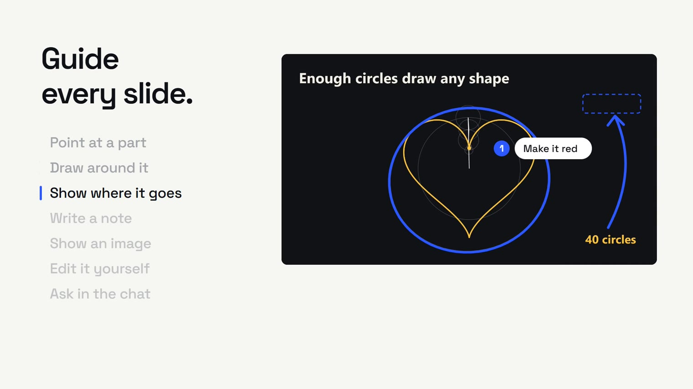

<p align="center">
  <picture>
    <source media="(prefers-color-scheme: dark)" srcset="docs/images/wordmark-dark.svg">
    
  </picture>
</p>

<h3 align="center">Talks, videos and reels made with math.<br>One slide at a time, with Claude.</h3>

<p align="center">
  
  
  
</p>

<p align="center">
  <a href="docs/images/trailer.mp4"></a>
  <br>
  <a href="docs/images/trailer.mp4"><b>Watch the trailer with sound</b></a>
</p>

<p align="center">
  
</p>

## Render one slide. Keep the others.

<p align="center"></p>

## Mark it

<p align="center"></p>

## Edit it yourself

<p align="center"></p>

## Claude fixes it

<p align="center"></p>

## Videos and reels, with music

<p align="center"></p>

## Step by step

| | |
| --- | --- |
| <br>**New talk** | <br>**Render pending** |
| <br>**Mark on the slide** | <br>**Send to Claude** |
| <br>**Approve** | <br>**Export: HTML, PDF, MP4, GIF** |
| <br>**New slide** | <br>**Web panel** |

## Examples

| [Drawing with circles](examples/fourier-circles/) | [A butterfly in the equations](examples/strange-attractor/) |
| --- | --- |
|  |  |

## The folder of a talk

```text
my-talk/
  termina.json   what the talk is: title, topic, language, resolution
  main.py        the order of the slides
  style.py       the colors and the font
  slides/        the code of the slides, one .py file for each slide
  pictures/      the pictures that you add to the slides
  export/        your exports: HTML, PDF, MP4, PowerPoint
  .termina/      the renders. You can delete this folder. Termina renders the slides again.
```

If the folder holds more than the talk, for example practice notebooks, put the talk in
`my-talk/presentation/`. Termina changes the names of an older talk when it opens the talk:
`diapositivas/` becomes `slides/`, `diapos/` becomes `.termina/` and `talk.manimrs` becomes
`termina.json`. The renders stay correct.

## Installation

Pre-release: there is no installer. These programs are necessary: [uv](https://docs.astral.sh/uv/),
[FFmpeg](https://ffmpeg.org/), [Rust](https://rustup.rs/), [Node.js](https://nodejs.org/) 20+ and
[Claude Code](https://claude.com/claude-code). Clone it into the folder that holds your talks.

```powershell
git clone https://github.com/JeroHoyos/manimrs-studio.git termina
cd termina\frontend; npm ci; npm run build; cd ..
cargo build --release
.\target\release\termina.exe
```

## Contribution

Small pull requests. Before you send one: `uv run pytest`, `uv run complexipy .`, build the app.

## License

[MIT](LICENSE). Built on [Manim Community](https://www.manim.community/),
[ManimGX](https://github.com/academa-labs/manimgx) and
[Manim Slides](https://github.com/jeertmans/manim-slides). Not a part of those projects or of
Anthropic. Claude is a trademark of Anthropic.
