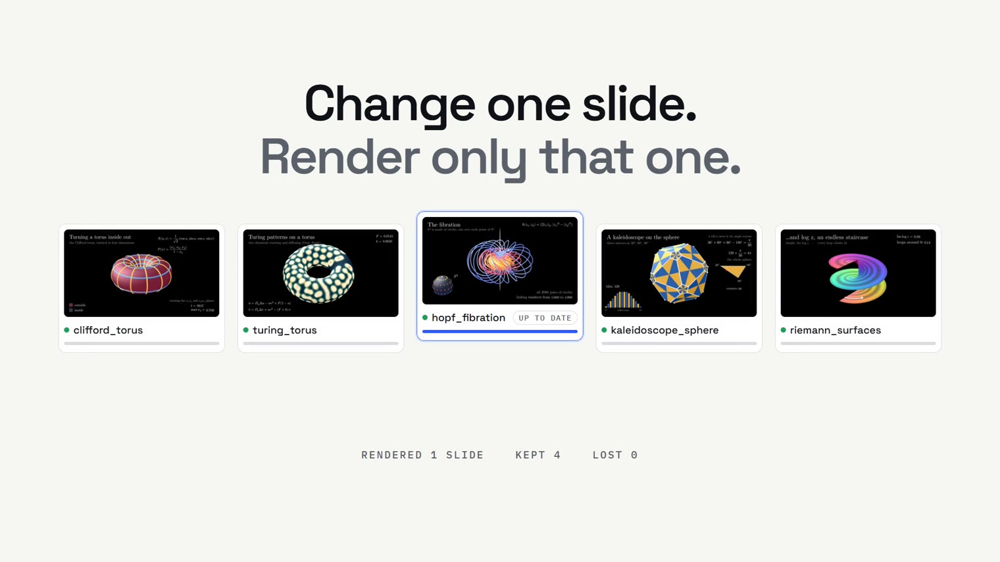
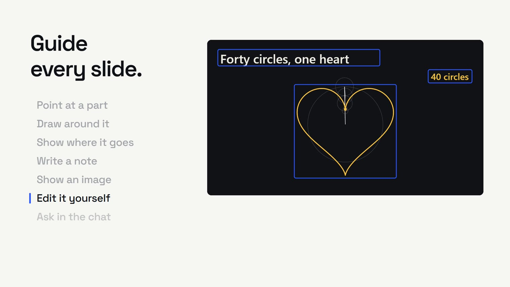
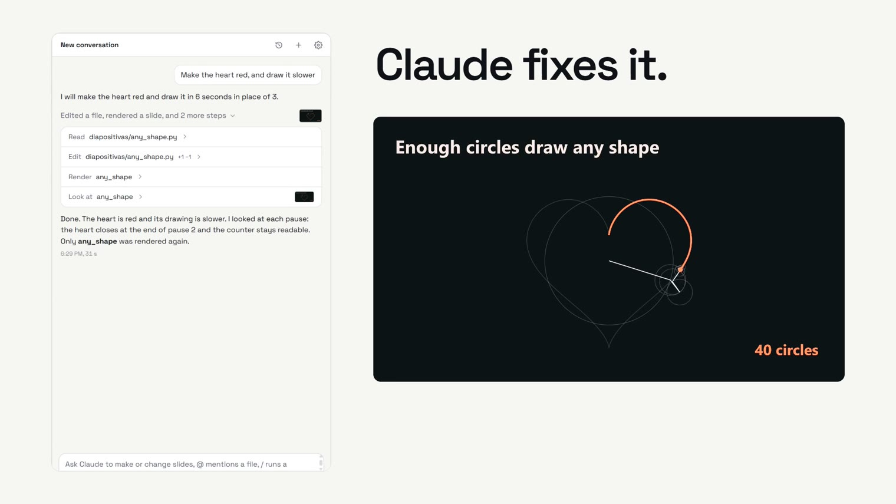
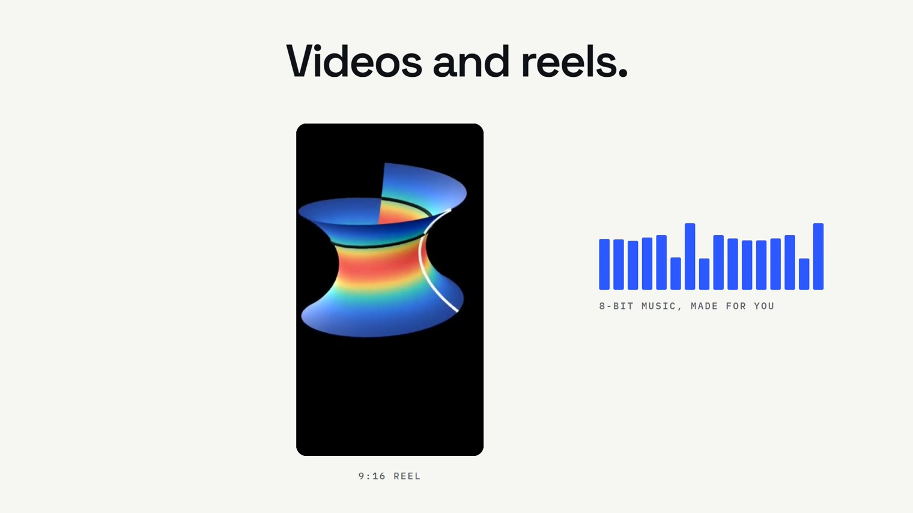

<p align="center">
  <picture>
    <source media="(prefers-color-scheme: dark)" srcset="docs/images/wordmark-dark.svg">
    
  </picture>
</p>

<h3 align="center">Talks, videos and reels made with math.<br>One slide at a time, with Claude.</h3>

<p align="center">
  
  
  
</p>

<p align="center">
  <a href="docs/images/trailer.mp4"></a>
  <br>
  <a href="docs/images/trailer.mp4"><b>Watch the trailer with sound</b></a>
</p>

Termina is an open-source desktop app for [Manim Slides](https://github.com/jeertmans/manim-slides).
You write each slide in Python, with the animations of Manim. Termina renders only the slide that
changed. You point at what is wrong, and Claude fixes it.

> [!IMPORTANT]
> **This is a pre-release. Version 1.0 is not out.** There is no installer, Linux is experimental,
> and the file formats can change. The project does not take donations at this time.

<p align="center">
  
</p>

## Render one slide. Keep the others.

Manim Slides renders a talk as one scene. If you render some slides, you lose the other slides.
If you render all the slides, you wait for all of them.

Termina keeps each slide in a file of its own, with its videos. *Render pending* renders only the
new slides and the slides that changed. Each slide still starts with the transition from the slide
before it.

<p align="center">
  
</p>

## Guide every slide.

Tell Claude what you want in the way that is easiest for you. Use one way, or use them together.

<p align="center">
  
</p>

| Way | How |
| --- | --- |
| **Point at a part** | In *Mark on the slide*, click a part of the frame and write what to change there. |
| **Draw around it** | Drag on the frame to draw a line around an element. |
| **Show where it goes** | Drag from an element to its new position. The app draws an arrow. |
| **Write a note** | Write in *Review*. Save many notes, then send them together. |
| **Show an image** | Attach, paste or drop an image in the note, for example a sketch. |
| **Edit it yourself** | Click *Edit on the slide*. Drag an object, retype a text or a formula, or add an element. |
| **Ask in the chat** | Type a request. `@` mentions a file and `/` runs a command. Or click *Improve this slide*. |

The marks go to Claude as an image of the frame, with your note. Refer to
[Mark on the slide](docs/usage-guide.md#mark-on-the-slide) and
[Edit on the slide](docs/usage-guide.md#edit-on-the-slide).

<p align="center">
  
</p>

## Claude fixes it.

The chat is [Claude Code](https://claude.com/claude-code), inside the window. Claude edits the
slide, renders it, and examines the image of each pause. Then it shows you the result. When the
slide is correct, click *Approve*.

<p align="center">
  
</p>

## Videos and reels, with music.

A video has no pauses: its scenes play one after the other in one MP4. A reel is a vertical video
at 9:16, for the phone. Put your music under it, or let Termina make new 8-bit music.

<p align="center">
  
</p>

## And more

| | |
| --- | --- |
| **Present** | Full screen, with the presenter of Manim Slides. |
| **Export** | HTML, PDF, MP4 and GIF. |
| **ManimGX first** | The engine tries [ManimGX](https://github.com/academa-labs/manimgx) first. If it fails, Manim CE renders. |
| **Your agent, your model** | The tools of the app are an MCP server. Refer to [Other agents](docs/other-agents.md). |
| **480p, 720p, 1080p** | Review at 480p. Present at 1080p. |
| **Windows and Linux** | The app runs on Windows 10 and 11. Linux is experimental. |

## Examples

The repository has two [example talks](examples/README.md).

| Drawing with circles | A butterfly in the equations |
| --- | --- |
|  |  |
| [`examples/fourier-circles`](examples/fourier-circles/) | [`examples/strange-attractor`](examples/strange-attractor/) |

## Installation

There is no installer at this time. Build the app from the source. These programs are necessary:
[uv](https://docs.astral.sh/uv/), [FFmpeg](https://ffmpeg.org/), [Rust](https://rustup.rs/) and
[Node.js](https://nodejs.org/) 20 or later. The chat also uses
[Claude Code](https://claude.com/claude-code).

Put this repository in the folder that holds your talks. If you do not have talks, use an empty
folder.

```powershell
git clone https://github.com/JeroHoyos/manimrs-studio.git termina
cd termina\frontend
npm ci
npm run build
cd ..
cargo build --release
.\target\release\termina.exe
```

macOS is not supported. Refer to [Installation](docs/installation.md) and
[Problems and solutions](docs/problems.md).

## Usage

1. Start the app and click *New talk*. In *What you make*, select a talk, a video or a reel.
2. Click *Render 2 pending*. The first time, the talk installs its Python packages.
3. Click *Mark on the slide*, or write what to change in *Review*. Then click *Send to Claude*.
4. When the slide is correct, click *Approve*.
5. Click *Present* for full screen, or *Export* for HTML, PDF or MP4. A video or a reel exports
   to MP4.

The [tutorial](docs/tutorial.md) shows each step with images. The [documentation](docs/index.md)
has the rest.

## Status and Roadmap

- **Good today:** render one slide, review with marks, the Claude chat, the exports, videos and
  reels, Windows.
- **Thin:** Linux, other agents, the types of the window code.
- **Not started:** installers, macOS, the interface in Spanish.

The steps to version 1.0 are an installer (0.7), strict TypeScript and themes (0.8), a second
agent in the chat (0.9), then macOS and stable formats (1.0).

## Contribution

Pull requests are welcome. Keep each one small: one feature or one fix. Before you send it, run
the tests and the complexity check, then build the app and examine the change in the window:

```powershell
uv sync
uv run pytest
uv run complexipy .
cd frontend
npm ci
npm run build
cd ..
cargo build --release
```

[How it works](docs/how-it-works.md) shows the parts of the code. Write code, comments and
documentation in English, with the [documentation style](docs/writing-style.md).

Report bugs and ideas in the [issues](https://github.com/JeroHoyos/manimrs-studio/issues). Do not
report a vulnerability in a public issue. Use *Report a vulnerability* in the *Security* tab.

## License

Termina is free software under the [MIT License](LICENSE). The app includes marked (MIT),
DOMPurify (Apache-2.0 or MPL-2.0), Space Grotesk and IBM Plex Mono (SIL Open Font License 1.1), in
`frontend/apps/studio/public/`.

Termina stands on [Manim Community](https://www.manim.community/),
[ManimGX](https://github.com/academa-labs/manimgx) and
[Manim Slides](https://github.com/jeertmans/manim-slides). The
[3Blue1Brown videos](https://github.com/3b1b/videos) are the model for the example talks,
[Recordly](https://github.com/webadderallorg/Recordly) for this page and
[ArtCraft](https://github.com/storytold/artcraft) for the layout of the code. The
project is not a part of Manim Community, ManimGX, Manim Slides or Anthropic. Claude is a trademark of
Anthropic. The music of the trailer is original. Its 8-bit part comes from the 8-bit music of Termina.
